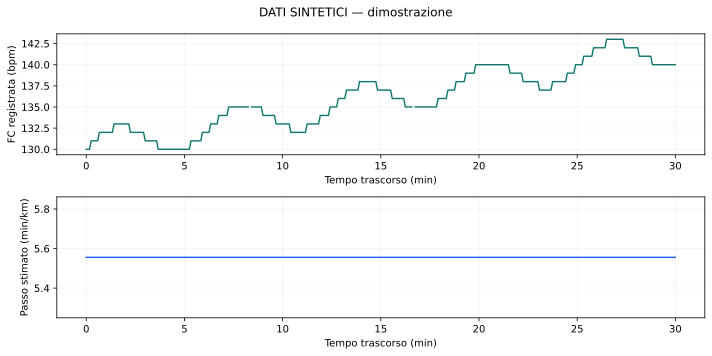

# Hybrid Training Analytics

Local analytics for treadmill running and strength sessions with incomplete data.

**Work in progress.** The software runs locally; exercise suggestions are experimental
and have not been validated for real-world recognition accuracy. It is a
research prototype; see the verified behavior and limitations below.

## The problem

A treadmill activity can have different distances in its session summary and
sample-level trace. Strength recordings can contain forgotten set markers,
unhelpful exercise names, missing loads, and uncertain repetitions. A complete
training diary should not require pretending those missing values are known.

## The approach

- Parse Garmin FIT files with CRC validation and normalize timestamps to UTC.
- Preserve recorded channels, device estimates, user declarations, and calculated
  inferences as separate data with explicit units and provenance.
- Generate offline HTML/SVG reports and reproducible JSON/CSV outputs.
- Keep distance scaling in a separate derivative; never overwrite the source trace.
- Save a strength session even when no sets or exercises are remembered.
- Offer optional timeline editing and explainable exercise suggestions with abstention.
- Describe running/strength context without claiming physiological interference or recovery.

Python 3.12+, a `src` layout, a small CLI, and a loopback-only interface. Runtime
dependencies are **fitdecode, matplotlib, and tzdata**; `uv.lock` pins the environment.
No cloud service, Garmin login, API key, database, or personal dataset is needed.
The current browser interface and some detailed messages are in Italian.

## Quick start

Install [uv](https://docs.astral.sh/uv/getting-started/installation/), then open a
terminal in the repository root. The following commands work in PowerShell and
POSIX shells; the first installation needs internet access for public packages
and may download Python 3.12. No global Python installation or environment
activation is required.

```text
uv sync --locked --python 3.12
uv run --locked python scripts/check.py
uv run --locked python -m hybrid_training_analytics demo --out reports/demo
```

Open `reports/demo/report.html` in a browser. It is self-contained and works
without a server or internet connection. The demo generates its own invented FIT
records and strength diary: **no personal files are required**.



The output directory must not exist. For a second run, choose `reports/demo-2`.
The Python module invocation is intentional: it avoids a launcher issue observed
with the generated `hta.exe` entry point on one Windows environment.

## Reproduce an analysis

```text
uv run --locked python -m hybrid_training_analytics report reports/demo/run.json --config reports/demo/analysis.json --out reports/reproduced
```

This restores the original configuration, including declared treadmill settings
and RPE. Within the same software environment the analysis, SVG and HTML are
byte-identical. Fonts and rendering may differ across environments; software
versions and parameters are recorded. Reusing an existing output is rejected.

## Try the strength workflow without real data

```text
uv run --locked python -m hybrid_training_analytics strength-reconcile-demo --out reports/strength-demo
uv run --locked python -m hybrid_training_analytics serve --workspace reports/strength-demo/workspace --port 0
```

Open the complete URL printed by `serve`, including the fragment after `#`, then
choose **Riconciliazione forza FIT**. Stop the server with Ctrl+C. It binds only
to `127.0.0.1`; the session token is generated locally. Run only one server per
workspace. The demo includes both motion data and deliberately noisy device hints.

The minimum session form can save unknowns. The detailed editor supports explicit
assignment, split/merge and missing sets; only user-confirmed sets contribute known
volume. A remembered exercise name alone does not establish repetitions or kg.

## Use your own data locally

Supply your own paths; these files are never required by the examples or tests:

```text
uv run --locked python -m hybrid_training_analytics import "path/to/run.fit" --timezone Europe/Rome --out reports/my-run
uv run --locked python -m hybrid_training_analytics strength-fit "path/to/strength.fit" --out reports/my-strength
uv run --locked python -m hybrid_training_analytics strength-report examples/strength_synthetic.csv --out reports/strength-csv
```

The strength command also accepts a ZIP containing exactly one FIT. Default
running reports do not present pace or drift as reliable without the required
independent declarations and quality checks. See [methodology](docs/METHODOLOGY.md).
For distance derivatives, phase analysis and hybrid reports, see the CLI:

```text
uv run --locked python -m hybrid_training_analytics --help
```

## What is verified

The validation is recorded in [VERIFICATION.md](docs/VERIFICATION.md).
It checks a fresh environment from selected files, the complete synthetic test
suite, reproducible reports, and wheel contents. After the independent review
fixes, the suite passes **205 tests** (199 at the original baseline, plus six
regression tests for timer pauses, import scratch files and malformed requests).
These are correctness and robustness checks, not recognition-accuracy benchmarks.

All committed CSV examples are invented. The SVG above is generated from the
synthetic demo; [data provenance](docs/DATA_PROVENANCE.md) explains its source.

## Architecture

```text
FIT / CSV -> validated domain objects -> quality and metrics -> offline reports
                                      -> local annotations and immutable revisions
                                      -> optional strength reconciliation / evaluation
```

| Area | Responsibility |
|---|---|
| `ingestion`, `strength_fit`, `strength_input` | FIT/ZIP parsing, CRC and normalized inputs |
| `metrics`, `signals`, `advanced_metrics`, `calibration` | Supported temporal metrics and separate derivatives |
| `strength`, `hybrid` | Declared strength data and descriptive concurrent context |
| `strength_quality`, `reconciliation`, `strength_sessions` | Evidence quality, optional editing and partial sessions |
| `strength_evaluation` | Frozen predictions, separate remembered labels and explicit denominators |
| `local_catalog`, `local_web` | Private local storage and authenticated loopback UI |

[Data contract](docs/DATA_CONTRACT.md) · [Methodology](docs/METHODOLOGY.md) ·
[Local evaluation protocol](docs/LOCAL_TRIAL_PROTOCOL.md) · [Roadmap](docs/ROADMAP.md)

## Limitations and privacy

Missing values remain missing. Heart-rate coverage is not sensor accuracy. The
software does not estimate a lifting load from wrist signals, infer individual
heart-rate zones/VO2max, prescribe progression, or provide medical advice.
Accelerometer data may be absent from exported FIT files. Exercise rankings are
heuristic alternatives; abstention is an expected outcome. Remembered labels are
user declarations, not independently measured ground truth.

Real FIT files, private notes, local catalogs, generated reports, caches and
virtual environments stay out of Git, including private repositories. Review the
selected files before every upload; `.gitignore` alone is not a privacy audit.
No historical development chats, author-machine paths or unrelated Git history are included.
Only source code, documentation and synthetic examples are intended for public sharing.

## License

Software, tests and synthetic CSV examples are licensed under [MIT](LICENSE).
Documentation and the original synthetic illustration are licensed under
[CC BY 4.0](LICENSE-DOCUMENTATION.txt); embedded code examples remain MIT.
See [licensing and attribution](LICENSING.md) for the exact scope and exclusions.

## Development

```text
uv run --locked python scripts/check.py
```

This checks the lock, lint, formatting and tests, using unique temporary directories.
Tests generate FIT bytes in memory; do not replace them with real recordings.
See [CONTRIBUTING.md](CONTRIBUTING.md). Keep changes small and preserve scientific
provenance, unknown values and the distinction between observation and inference.

On Windows, use a short checkout path (for example a GitHub projects folder).
Deeply nested paths can exceed native DLL filename limits even when Python installs successfully.
